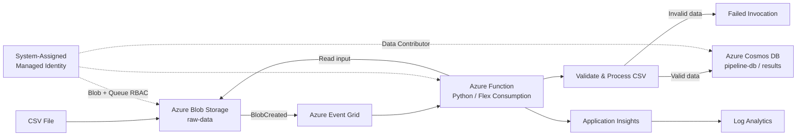
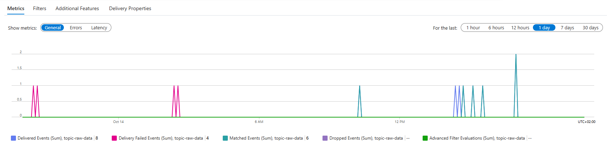
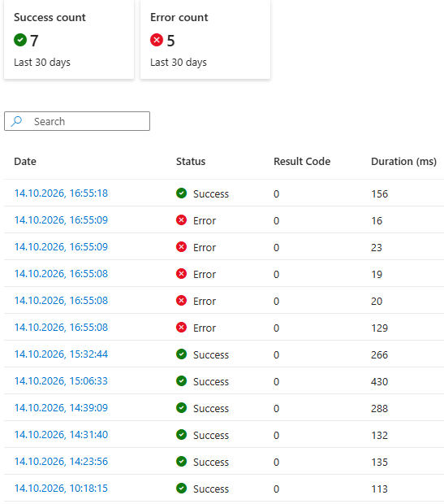
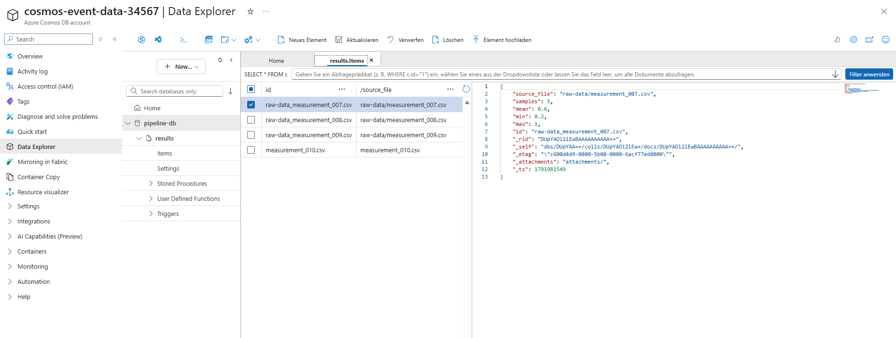

# Azure Event-Driven Data Pipeline

A serverless, event-driven data processing pipeline built with Microsoft Azure and Python.

The project demonstrates how Azure services can be combined to automatically process uploaded CSV files, validate and transform their contents, store structured results, and monitor the complete workflow.

## Architecture



## Data Flow

1. A CSV file is uploaded to the private `raw-data` Blob Storage container.
2. Azure Event Grid detects the `BlobCreated` event.
3. Event Grid triggers the Python Azure Function.
4. The Function reads and validates the CSV data.
5. Basic statistics are calculated from the `signal` column.
6. The processed result is stored as a JSON document in Azure Cosmos DB.
7. Application Insights and Log Analytics provide monitoring and diagnostics.

An example input:

```csv
time,signal
0.0,0.20
0.1,0.40
0.2,0.60
0.3,0.80
0.4,1.00
```

produces a result such as:

```json
{
  "id": "measurement_010.csv",
  "source_file": "measurement_010.csv",
  "samples": 5,
  "mean": 0.6,
  "min": 0.2,
  "max": 1.0
}
```

## Azure Services

| Service | Purpose |
|---|---|
| Azure Blob Storage | Stores incoming CSV files |
| Azure Event Grid | Detects new blobs and starts processing |
| Azure Functions | Executes the Python processing logic |
| Azure Cosmos DB for NoSQL | Stores structured processing results |
| Managed Identity | Authenticates the Function without application credentials |
| Azure RBAC | Controls access to Storage resources |
| Cosmos DB Data-Plane RBAC | Controls access to Cosmos DB documents |
| Application Insights | Captures Function telemetry and exceptions |
| Log Analytics | Enables centralized log analysis |

## Security and Identity

The Function App uses a **system-assigned Managed Identity** instead of storing Azure credentials in the application code.

The Function identity receives only the permissions required by the pipeline:

- `Storage Blob Data Owner`
- `Storage Queue Data Contributor`
- `Cosmos DB Built-in Data Contributor`

This project also demonstrates the distinction between the Azure **management plane** and individual service **data planes**.

Having permission to manage an Azure resource does not automatically grant permission to access the data stored inside it. Storage and Cosmos DB therefore require appropriate data-plane RBAC assignments.

Secrets and local configuration files are excluded from source control.

## Input Validation and Error Handling

The Function validates incoming files before writing results to Cosmos DB.

Invalid files, for example CSV files without a `signal` column, raise an error and do not create database entries.

Expected input errors and unexpected runtime exceptions are logged separately so that failures can be investigated through Azure monitoring.

## Monitoring

The pipeline was tested with both valid and intentionally invalid input files.

### Event Grid

Event Grid metrics show matched, delivered, and failed events during development and testing.



### Function Invocations

Successful processing and intentionally triggered validation failures are visible in the Function invocation history.



### Cosmos DB

Successfully processed files produce structured JSON documents in the `results` container.



## Troubleshooting and Lessons Learned

A significant part of the project involved diagnosing authentication and event-delivery issues across multiple Azure services.

One issue caused Event Grid deliveries to fail even though Blob Storage and the event filter were configured correctly.

The investigation followed this path:

```text
Event Grid delivery failure
        ↓
Event Grid metrics
        ↓
Application Insights exceptions
        ↓
HTTP 403 AuthorizationPermissionMismatch
        ↓
Azure Storage Queue access
        ↓
Missing data-plane permission
        ↓
Storage Queue Data Contributor
        ↓
Successful Function execution
```

This demonstrated that Azure Functions may require supporting Storage permissions in addition to direct Blob access.

Another important lesson was the distinction between management-plane and data-plane authorization. For example, Cosmos DB document access uses Cosmos-native data-plane RBAC and is separate from standard Azure resource-management permissions.

## Infrastructure as Code

The `infrastructure/` directory contains a Bicep representation of the Azure architecture.

It defines the main infrastructure components including:

- Storage Account and Blob container
- Cosmos DB account, database, and container
- Azure Function and Flex Consumption plan
- System-assigned Managed Identity
- Storage RBAC assignments
- Cosmos DB data-plane RBAC
- Application Insights and Log Analytics
- Event Grid resources

Resource names that must be globally unique are exposed as parameters rather than hard-coded.

The template can be compiled locally with:

```powershell
az bicep build --file infrastructure/main.bicep
```

The deployed Event Grid integration uses the Azure Functions Blob webhook, which requires a Functions system key. This secret is intentionally not stored in the repository or Bicep template.

See [`infrastructure/README.md`](infrastructure/README.md) for additional details.

## Project Structure

```text
azure-event-data-pipeline/
├── function_app/
│   ├── function_app.py
│   └── requirements.txt
├── infrastructure/
│   ├── main.bicep
│   └── README.md
├── sample_data/
├── tests/
├── docs/
│   ├── architecture.md
│   └── screenshots/
│       ├── event-grid-monitoring.png
│       ├── function-invocations.png
│       └── cosmos-result.png
├── .gitignore
└── README.md
```

## Technologies

- Python
- Microsoft Azure
- Azure Functions
- Azure Blob Storage
- Azure Event Grid
- Azure Cosmos DB
- Azure Managed Identity
- Azure RBAC
- Application Insights
- Log Analytics
- Bicep
- Azure CLI
- Git / GitHub

## Key Takeaways

This project focuses on Azure architecture rather than complex data-processing logic.

It demonstrates practical experience with:

- event-driven cloud architectures
- serverless computing
- Azure identity and RBAC
- secure service-to-service authentication
- NoSQL data storage
- monitoring and troubleshooting
- Infrastructure as Code
- cloud-based Python deployment